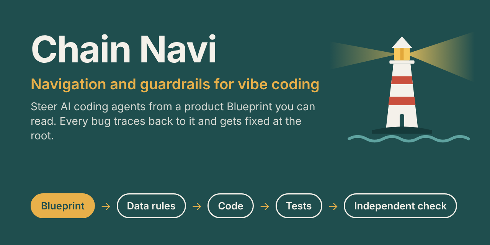

<p align="center">
  
</p>

<p align="center">
  <a href="LICENSE"></a>
  
  
</p>

# Chain Navi

**Your vibe-coded app is halfway there — and every fix breaks something else?**

Chain Navi gives your AI coding agents a map and guardrails. Every bug is traced
back to one plain-language document you can read — the **Blueprint** — and
fixed at the root instead of patched on top. You keep control of what the
product means. The AI handles the rest, proves its work, and stops before
anything you can't undo — that is what it instructs the AI to do.

It works when you start from zero. **It is built for when you're stuck in the
middle.**

> Everything here was made by AI and is shared as an idea for others facing
> the same problem. We cannot answer technical questions.
> [Read more](#made-entirely-by-ai)

---

## Sound familiar?

The first weeks of vibe coding feel like magic. Then:

- 🐛 **Bugs keep coming back.** Every fix is a patch on a patch, and each one
  breaks something else.
- 🔁 **Agents undo each other.** Two sessions understand the same rule
  differently and keep "fixing" each other's work.
- 🤷 **"Fixed!" — but is it?** You can't read the code, so you can't tell.
- ❓ **You're asked questions you can't answer**, while decisions that really
  are yours get made without you.

The problem isn't that the AI isn't smart enough. It's that nobody — human or
AI — has one answer to **what is right, who decides, and how it's proven.**

---

## What changes

| Without Chain Navi | With Chain Navi |
| --- | --- |
| The bug is patched where it shows up | The bug is traced back to the Blueprint and fixed where it starts |
| "Fixed!" | A test that failed before and passes after, rerun by a separate AI session |
| Each session guesses what you meant | Every session reads the same Blueprint |
| Technical questions you can't answer | One plain question with a recommendation — only when it's really your call |
| The AI publishes, deletes or migrates on its own | The AI is instructed to wait for your "go" before anything irreversible |
| Rules pile up until the process is the problem | Every rule must name the accident it prevents, or it goes |

---

## What it sounds like

> **You:** My export shows a different total than the screen. Again.
>
> **AI:** Found it. Your Blueprint says *B1: "When I record a $12.00 payment, both
> the screen and my export show $12.00."* The export reads an old copy of the
> total, so it falls behind. I fixed it at the source, so the screen and the
> export now read the same number. A test that failed before now passes.
> Next: a separate reviewer session will check it.

> **AI:** One question. When someone records a payment on 31 October but dates
> it 3 November, should it count in October's total? **I recommend no**: it
> counts in November, the month of its date.

> **AI:** **STOP — I need your decision, because** publishing this update reaches real
> users. Everything is tested and reviewed. Reply "go" to publish this one
> update.

---

## Get started

### Claude Code

Claude Code 2.1.275 or later — one command:

```
/plugin install chain-navi --marketplace zendonlabs/chain-navi
```

Any version (or if the command above gives an error) — two commands:

```
/plugin marketplace add zendonlabs/chain-navi
/plugin install chain-navi@chain-navi
```

Then open your project and say:

> Use Chain Navi. Read this project and interview me to write our Blueprint.

### Any AI coding agent — paste this

Works in Claude Code, Codex, Cursor, Windsurf and others:

```text
Download these two files (Chain Navi v0.1.0) into docs/chain-navi/ in this project:
https://raw.githubusercontent.com/zendonlabs/chain-navi/v0.1.0/skills/chain-navi/CHAIN.md
https://raw.githubusercontent.com/zendonlabs/chain-navi/v0.1.0/skills/chain-navi/BLUEPRINT.md
If those files already exist and are different, do not overwrite them: keep
mine, and tell me in plain words what the new version changes.
Add a line to our agent instructions file (CLAUDE.md or AGENTS.md) saying:
"Follow docs/chain-navi/CHAIN.md. Talk to me in plain words."
Then read the whole project and interview me to write our Blueprint,
following BLUEPRINT.md.
```

Or, for Claude Code, copy the [`skills/chain-navi/`](skills/chain-navi/) folder
into `.claude/skills/` in your project. For other agents, use the paste-in
prompt above.

### Then

1. **Answer the AI's questions.** For a half-built app, it reads what you have
   first, asks what's going wrong, and drafts the Blueprint from both. You
   confirm it.
2. **Work as usual.** Describe features and bugs in everyday words.
3. **Get a second opinion.** When a piece of work is done, open a **new
   session** and say:

   > You are the reviewer. Check the latest change against our Blueprint,
   > following Chain Navi.

4. **Check it yourself.** Before anything ships, try the finished change on
   your own phone or computer against its Blueprint scenario.

> **Chain Navi is a set of instructions, not a lock.** AI agents usually follow
> it, but nothing forces them to. Keep your AI tool's own permission prompts
> on for publishing, deleting and payments.

No service, account, dashboard or particular AI model is required.

---

## How it works

**Blueprint → data rules → actual code → tests → independent check**

1. **The Blueprint** — what the product should do, as simple scenarios in your
   words: *"When I do X, I see Y."* The AI drafts it by interviewing you; you
   confirm it.
2. **Data rules** — the AI maps what each piece of data means and where it's
   really written and read, so every screen gets its answer from one place.
3. **Root-cause fixes** — for every bug, the AI finds the first place the
   software disagrees with the Blueprint and fixes it there.
4. **Proof** — a test named after the scenario fails before the fix and passes
   after.
5. **An independent check** — a different session reviews the change against
   the Blueprint and reruns the tests itself. The builder never reviews its own
   work.

You decide only product questions: what users should see, what must not
change, which number is right when two screens disagree, when something is
good enough to ship, anything irreversible, and conflicts the evidence can't
settle. The AI asks them as plain "when the user does X, should they see Y?"
questions. Everything else is the AI's job.

---

## Why it exists

Chain Navi was born while building **Own24**, an app made entirely with AI
agents by an owner who cannot read code.

Early on, things moved fast. Later, the process slipped out of control. Bugs
kept coming, every fix was a patch on a patch, and there was nothing to do
but watch. The way out wasn't a smarter AI. It was a chain that every problem
could be traced back along — to one place the owner *can* read: the
Blueprint. Once every bug had to go back to the Blueprint and be fixed at the
root, the patches stopped piling up, and the owner finally had control.

Own24 is live: [own24.app](https://own24.app/) ·
[App Store](https://apps.apple.com/us/app/own24/id6761209502)

---

## What's inside

| Path | What it is |
| --- | --- |
| [`skills/chain-navi/CHAIN.md`](skills/chain-navi/CHAIN.md) | The method, for the AI: roles, your decisions, the task loop, review, testing, how to talk to you. |
| [`skills/chain-navi/BLUEPRINT.md`](skills/chain-navi/BLUEPRINT.md) | How the AI interviews you — for a new or a half-built project — plus the Blueprint template. |
| [`examples/blueprint-example.md`](examples/blueprint-example.md) | A finished Blueprint for a small fictional app. |
| [`examples/one-payment.md`](examples/one-payment.md) | One bug, from Blueprint to root-cause fix to independent check. |

The whole method is two Markdown files. No code, no dependencies.

---

## FAQ

**Do I need to know how to code?**
No. That's who it's for. You answer plain questions about your product; the AI
does the rest.

**My project is already a mess. Is it too late?**
That's the best time to start. The AI drafts the Blueprint from what your app
does today plus your list of problems, then fixes them one by one at the root.
No rewrite.

**Which AI tools does it work with?**
Any agent that can read files in your project: Claude Code, Codex, Cursor,
Windsurf and others.

**Isn't this just a spec or PRD?**
A spec describes what to build once. The Blueprint is the rule every bug fix
and every review is checked against, for the life of the project — and you
don't write it, the AI interviews you for it.

**Will it slow my agents down?**
It adds a test and a review per change. In return, fixes stop undoing each
other. The method also forbids adding process that costs more than the problem
it prevents.

---

## Made entirely by AI

- **Everything in this repository was made by AI.** The method, the documents,
  the examples and this README were written by AI agents (Claude, building on
  a method first developed with Claude and Codex),
  directed by an owner who does not write code. The method itself was
  developed the same way, while building Own24.
- **It is shared as an idea, not as a product.** We are publishing it because
  others building software with AI may be facing the same problem we did. If
  it helps you find your own way, it has done its job.
- **We cannot answer technical questions.** We are not able to provide
  technical support, explain implementation details, or help debug your
  project. Issues and pull requests may go unanswered.
- **Use it freely.** Copy it, change it and adapt it under the MIT license.
  Your own AI agent is the best place to ask how to apply it.

If Chain Navi helps you, a ⭐ helps others who are stuck find it.

---

## Contact

ZendonLabs — [hello@zendonlabs.com](mailto:hello@zendonlabs.com)
(General enquiries only. We cannot answer technical questions.)

## License

[MIT](LICENSE) © ZendonLabs
